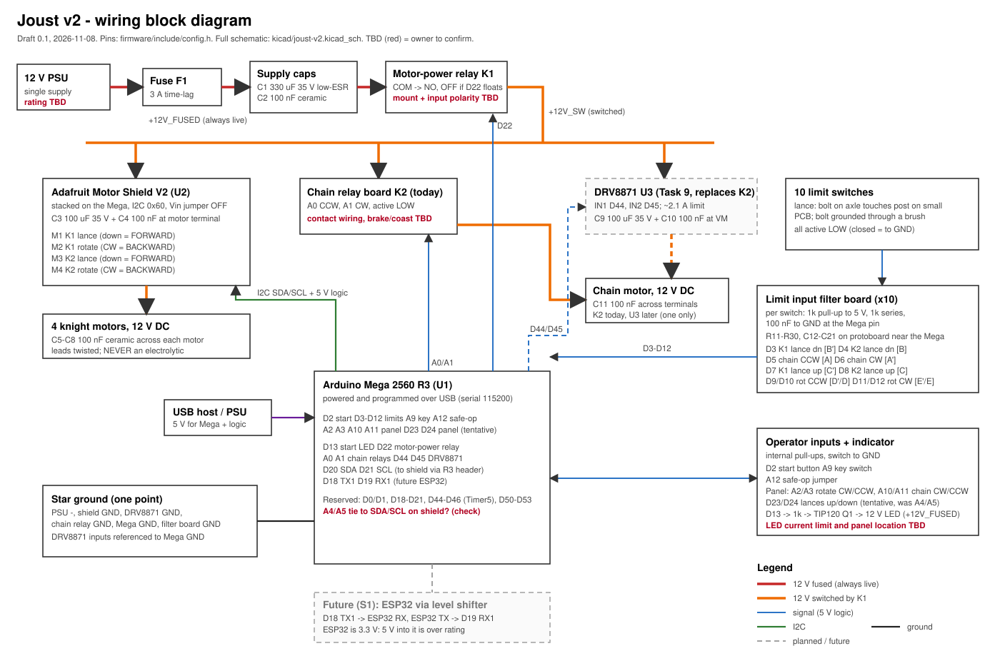

# Joust v2 wiring

Draft 0.1, 2026-11-08, for owner review. Pins: `firmware/include/config.h` is the source of truth; if a pin changes, change it there first.

| File | What |
| --- | --- |
| `joust-v2-block.svg` | One-page block diagram: power and signal paths |
| `kicad/joust-v2.kicad_sch` | Full schematic (KiCad 9). Open `kicad/joust-v2.kicad_pro` |
| `joust-v2-schematic.pdf` | Schematic export, for printing |
| `bom.md` | Parts v2 adds, and the order list |
| `tools/gen_schematic.py` | Generated the first schematic. Edit in KiCad from now on; re-running needs `--force` and discards KiCad edits |

## Pin table

All inputs switch to GND, active LOW, with a pull-up. Limits have the external RC filter (1 kOhm pull-up to 5 V, 1 kOhm series, 100 nF to GND at the pin); the other inputs use the internal pull-up.

| Pin | Name in config.h | Function | Dir | Notes |
| --- | --- | --- | --- | --- |
| D0, D1 | - | USB serial | - | Reserved |
| D2 | PIN_START_BUTTON | Start button | In | |
| D3 | PIN_K1_LANCE_DOWN | K1 lance down [B'] | In | RC filter (SW1) |
| D4 | PIN_K2_LANCE_DOWN | K2 lance down [B] | In | RC filter (SW2) |
| D5 | PIN_CHAIN_CCW | Chain CCW [A] | In | RC filter (SW3) |
| D6 | PIN_CHAIN_CW | Chain CW [A'] | In | RC filter (SW4) |
| D7 | PIN_K1_LANCE_UP | K1 lance up [C'] | In | RC filter (SW5) |
| D8 | PIN_K2_LANCE_UP | K2 lance up [C] | In | RC filter (SW6) |
| D9 | PIN_K1_ROTATE_CCW | K1 rotate CCW [D'] | In | RC filter (SW7) |
| D10 | PIN_K2_ROTATE_CCW | K2 rotate CCW [D] | In | RC filter (SW8) |
| D11 | PIN_K1_ROTATE_CW | K1 rotate CW [E'] | In | RC filter (SW9) |
| D12 | PIN_K2_ROTATE_CW | K2 rotate CW [E] | In | RC filter (SW10) |
| D13 | PIN_LED | Start-button LED (and onboard LED) | Out | HIGH = on. 1 kOhm to the base of Q1 (TIP120 Darlington, low side), which switches the 12 V button LED |
| D18, D19 | - | Serial1 TX1 / RX1 | - | Reserved: future ESP32 via level shifter |
| D20, D21 | - | I2C SDA / SCL to the shield | - | Reserved |
| D22 | PIN_MOTOR_POWER | Motor-power relay K1 | Out | Tentative pin. OFF while floating |
| D23 | PIN_PANEL_LANCES_UP | Panel: both lances up | In | Tentative, was A4 |
| D24 | PIN_PANEL_LANCES_DOWN | Panel: both lances down | In | Tentative, was A5 |
| D44, D45 | (Task 9) | DRV8871 IN1 / IN2 | Out | Timer5. D46 reserved too |
| D50-D53 | - | SPI | - | Keep spare |
| A0 | PIN_CHAIN_RELAY_CCW | Chain relay CCW | Out | Active LOW. Removed at Task 9 |
| A1 | PIN_CHAIN_RELAY_CW | Chain relay CW | Out | Active LOW. Removed at Task 9 |
| A2 | PIN_PANEL_ROTATE_CW | Panel: both rotate CW | In | |
| A3 | PIN_PANEL_ROTATE_CCW | Panel: both rotate CCW | In | |
| A4, A5 | - | Not used | - | May be tied to SDA/SCL on the shield (open item 3) |
| A9 | PIN_UNLOCK_KEY | Key switch | In | |
| A10 | PIN_PANEL_CHAIN_CW | Panel: chain CW | In | |
| A11 | PIN_PANEL_CHAIN_CCW | Panel: chain CCW | In | |
| A12 | PIN_SAFE_OP | Safe-op jumper | In | Jumper to GND = safe-op |

## Motors

| Motor | Driver | Direction (config.h) | Cap |
| --- | --- | --- | --- |
| K1 lance | Shield M1 | down = FORWARD | C5 100 nF |
| K1 rotate | Shield M2 | CW = BACKWARD | C6 100 nF |
| K2 lance | Shield M3 | down = FORWARD | C7 100 nF |
| K2 rotate | Shield M4 | CW = BACKWARD | C8 100 nF |
| Chain | Relays A0/A1 today; DRV8871 D44/D45 at Task 9 | which IN drives CW: bench | C11 100 nF |

## Power

- 12 V PSU -> F1 3 A time-lag -> C1 330 uF + C2 100 nF -> K1 relay COM/NO -> +12V_SW to the shield motor terminal (C3 100 uF + C4 100 nF) and the chain driver (C9 100 uF + C10 100 nF at the DRV8871 VM).
- Start-button LED: 12 V, fed from `+12V_FUSED` (before the relay) so it can still blink a fault after motor power is cut. Q1 (TIP120) switches its − side from D13 through R1 1 kOhm; Q1 emitter to the star ground. The TIP120 tab is the collector: insulate it if mounted on metal.
- Mega on USB. Shield Vin jumper OFF, so 12 V never reaches the Mega.
- All grounds meet at one point. The DRV8871 inputs are referenced to Mega GND.

## Open items (owner)

1. 12 V supply current rating, and the wire gauges in use.
2. Where the panel, key and start button sit, and which connectors or terminals each harness uses.
3. Does the shield tie A4/A5 to SDA/SCL? Continuity check, power off.
4. Where the motor-power relay board mounts; its input polarity (most boards are active LOW).
5. Start LED: does it limit its own current (meter in series from 12 V: expect about 5-25 mA)? Are the LED terminals separate from the switch contacts?
6. Chain relay board: how the contacts drive the motor; does it brake or coast at stop?
7. `Electronics Pinout.xlsx` sheet 1 disagrees with config.h (it has K1 lance down on D7 and up on D3, the reverse of config.h, and lists D5/D6 as lance buttons). Sheet 2 matches config.h. Which sheet is current? This drawing follows config.h.
